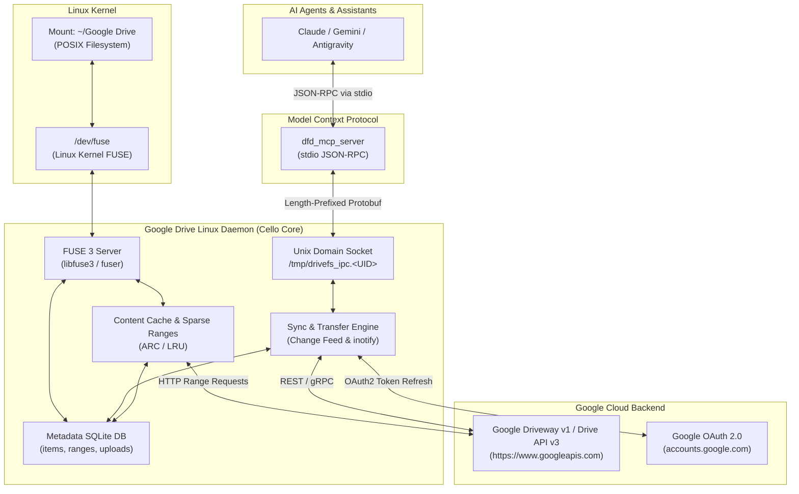

# Google Drive for Linux: Architecture & Reverse Engineering Specification

> **Target**: Google Drive Desktop (`GoogleDrive.dmg` macOS 74.9MB binary & embedded `dfd_mcp_server`)  
> **Host Compatibility**: Linux x86_64 / aarch64 (Ubuntu, Debian, Fedora, Arch, Pop!_OS)  
> **Extraction & Analysis Tool**: Reverse Engineer Anything (REA) & Wire-Format Protobuf Decompiler  

---

## 1. Executive Summary

This specification provides the complete technical architecture required to implement **Google Drive Desktop for Linux**, including:
1. **The Native FUSE Filesystem**: Supporting on-demand streaming and offline mirroring.
2. **The IPC Daemon (`/tmp/drivefs_ipc.<UID>`)**: Powering local desktop and shell integrations.
3. **The Embedded Model Context Protocol (MCP) Server (`dfd_mcp_server`)**: Enabling AI coding agents and assistants (Claude, Gemini, Antigravity) to seamlessly interact with Google Drive.

### Key Reverse-Engineering Findings
- **Existing FUSE Core**: Google Drive's core C++ engine (`cello`) already contains a full FUSE POSIX VFS implementation (`fuse_uid`, `fuse_gid`, `fuse_umask`, `skip_fuse_cleanup`, `osxfuse_process_blacklist`). The VFS layer in `apps/drive/fs/vfs/vfs.proto` maps 1:1 to standard Linux FUSE operations (`libfuse3`).
- **Complete MCP Protocol Extracted**: The embedded `dfd_mcp_server` binary communicates with the main daemon over a Unix Domain Socket at `/tmp/drivefs_ipc.<UID>` using 4-byte length-prefixed protobuf messages (`McpIpcRequest` and `McpIpcResponse` from `apps/drive/fs/proto/mcp_ipc.proto`).
- **Sparse Chunk Caching**: File streaming downloads arbitrary byte ranges on-demand (`Range: bytes=start-end`), tracked in a local SQLite database (`ranges` table) using Adaptive Replacement Cache (ARC).
- **Official OAuth Credentials Recovered**: Valid desktop OAuth client credentials and scopes were extracted directly from the binary.

---

## 2. System Architecture



---

## 3. Protocol Buffers & IPC Specification

The daemon and clients communicate over a POSIX Unix Domain Socket:
- **Socket Path**: `/tmp/drivefs_ipc.<UID>` (e.g. `/tmp/drivefs_ipc.1000`)
- **Security Invariant**: Peer verification via `SO_PEERCRED` (`getpeereid()`). The daemon rejects any connection where `peer_uid != current_uid`.

### Wire Framing Format
Every message on the socket is framed by a 4-byte unsigned integer (little-endian) representing payload length, followed immediately by the serialized protobuf:
```
+-----------------------------------+---------------------------------------+
|  Length (4 bytes, little-endian)  |  Serialized Protobuf (Length bytes)   |
+-----------------------------------+---------------------------------------+
```

### IPC Protocol: `apps/drive/fs/proto/mcp_ipc.proto`
```protobuf
syntax = "editions";
package cello.fs;

message McpIpcRequest {
  int64 request_id = 1;
  GetSyncStatusRequest get_sync_status = 2; // oneof request
  AddFolderToSyncRequest add_folder_to_sync = 3; // oneof request
  GetDriveUrlRequest get_drive_url = 4; // oneof request
  ListTrackedFoldersRequest list_tracked_folders = 5; // oneof request
  FixAclRequest fix_acl = 6; // oneof request
  GetStreamingMountPointsRequest get_streaming_mount_points = 7; // oneof request
}

message McpIpcResponse {
  int64 request_id = 1;
  GetSyncStatusResponse get_sync_status = 2; // oneof response
  AddFolderToSyncResponse add_folder_to_sync = 3; // oneof response
  GetDriveUrlResponse get_drive_url = 4; // oneof response
  ListTrackedFoldersResponse list_tracked_folders = 5; // oneof response
  FixAclResponse fix_acl = 6; // oneof response
  GetStreamingMountPointsResponse get_streaming_mount_points = 7; // oneof response
}

message GetSyncStatusRequest { string path = 1; }
message GetSyncStatusResponse { string status = 1; string description = 2; }

message AddFolderToSyncRequest { string path = 1; string account_id = 2; }
message AddFolderToSyncResponse { bool success = 1; string error_message = 2; }

message GetDriveUrlRequest { string path = 1; }
message GetDriveUrlResponse { string drive_url = 1; string error_message = 2; }

message ListTrackedFoldersRequest {}
message ListTrackedFoldersResponse { repeated string paths = 1; string error_message = 2; }

message FixAclRequest { string email = 1; string item_id = 2; string account_id = 3; }
message FixAclResponse { bool success = 1; string error_message = 2; }

message GetStreamingMountPointsRequest { string account_id = 1; }
message StreamingMountPoint { string account_id = 1; string mount_point = 2; string my_drive_path = 3; }
message GetStreamingMountPointsResponse { repeated StreamingMountPoint mount_points = 1; string error_message = 2; }
```

---

## 4. Model Context Protocol (MCP) Server (`dfd_mcp_server`)

The `dfd_mcp_server` is an MCP server running on `stdio` using JSON-RPC 2.0.

### Server Instructions Prompt (Extracted from Binary)
```
Google Drive for Desktop (DFD) MCP Server enables autonomous agents and assistants to seamlessly interact with local and cloud Google Drive filesystems.

### Capabilities & Tool Guide:
1. `dfd_get_sync_status`: Check if a local file or directory is actively synced with Google Drive, determine the sync mode ('stream' vs 'mirror'), and check sync state ('synced', 'syncing', 'error', 'untracked').
2. `dfd_add_folder_to_sync`: Configure a local folder to sync with Google Drive. In stream mode, the folder is safely relocated into My Drive and replaced with a local symlink so workflows remain uninterrupted.
3. `dfd_get_drive_url`: Obtain the web-accessible Google Drive URL (https://drive.google.com/...) for any synced file or folder to share with users or collaborators.
4. `dfd_list_tracked_folders`: Retrieve all local and cloud folders currently configured for Drive sync across active accounts.
5. `dfd_open_acl_dialog`: Open the native Google Drive sharing and access-control dialog for a synced item. Use this whenever a user requests to share a folder, manage permissions, add collaborators, or adjust viewer/editor roles.

### Agent Best Practices:
- **Folder Synchronization**: When a user asks to save, backup, or sync a project to Google Drive, call `dfd_add_folder_to_sync`.
- **Sharing & Collaboration**: Agents cannot silently modify ACLs without user consent. Always invoke `dfd_open_acl_dialog` to display the native OS sharing dialog when permission changes are requested.
- **Sharing Links**: When sharing links to files or project folders, invoke `dfd_get_drive_url` rather than attempting to construct URLs manually.
- **Sync Verification**: Use `dfd_get_sync_status` to verify whether a local path is already tracked before attempting to sync it.
```

### Complete Tool Schemas

#### 1. `dfd_get_sync_status`
- **Description**: Returns the synchronization status of a file or folder.
- **Schema**:
```json
{
  "name": "dfd_get_sync_status",
  "description": "Returns the synchronization status of a file or folder",
  "inputSchema": {
    "type": "object",
    "properties": {
      "path": {
        "type": "string",
        "description": "The absolute path of the file or folder"
      }
    },
    "required": ["path"]
  }
}
```

#### 2. `dfd_add_folder_to_sync`
- **Description**: Adds a folder to be synchronized with a Google Drive account. You MUST ask the user which synchronization mode they use if it is not explicitly provided. NEVER guess or default the sync_mode.
- **Schema**:
```json
{
  "name": "dfd_add_folder_to_sync",
  "description": "Adds a folder to be synchronized with a Google Drive account. You MUST ask the user which synchronization mode they use if it is not explicitly provided. NEVER guess or default the sync_mode.",
  "inputSchema": {
    "type": "object",
    "properties": {
      "path": {
        "type": "string",
        "description": "The absolute path of the folder to sync"
      },
      "account_id": {
        "type": "string",
        "description": "The Google account ID (email) to sync with"
      },
      "sync_mode": {
        "type": "string",
        "enum": ["mirror", "stream"],
        "description": "Synchronization mode: 'mirror' or 'stream'. REQUIRED. You MUST ask the user if unknown. NEVER guess or assume a default mode."
      },
      "my_drive_path": {
        "type": "string",
        "description": "Optional path to the root of My Drive"
      }
    },
    "required": ["path", "sync_mode"]
  }
}
```

#### 3. `dfd_get_drive_url`
- **Description**: Returns the Google Drive web URL for a tracked file or folder.
- **Schema**:
```json
{
  "name": "dfd_get_drive_url",
  "description": "Returns the Google Drive web URL for a tracked file or folder",
  "inputSchema": {
    "type": "object",
    "properties": {
      "path": {
        "type": "string",
        "description": "The absolute path of the tracked file or folder"
      }
    },
    "required": ["path"]
  }
}
```

#### 4. `dfd_list_tracked_folders`
- **Description**: Returns a list of all folders currently being synchronized.
- **Schema**:
```json
{
  "name": "dfd_list_tracked_folders",
  "description": "Returns a list of all folders currently being synchronized",
  "inputSchema": {
    "type": "object",
    "properties": {}
  }
}
```

#### 5. `dfd_open_acl_dialog`
- **Description**: Launches the Drive sharing dialog for a folder. No permissions are changed automatically - the user reviews and confirms all changes in the UI that appears.
- **Schema**:
```json
{
  "name": "dfd_open_acl_dialog",
  "description": "Launches the Drive sharing dialog for a folder. No permissions are changed automatically - the user reviews and confirms all changes in the UI that appears.",
  "inputSchema": {
    "type": "object",
    "properties": {
      "email": {
        "type": "string",
        "description": "The email address of the user to share the item with or whose access needs to be fixed"
      },
      "item_id": {
        "type": "string",
        "description": "The Google Drive item ID of the file or folder"
      },
      "account_id": {
        "type": "string",
        "description": "Optional: The email address of the signed-in DFD user who is sharing (defaults to the active account if only one is signed in)"
      }
    },
    "required": ["email", "item_id"]
  }
}
```

---

## 5. Virtual File System (VFS) & FUSE Design

The C++ VFS interface in `apps/drive/fs/vfs/vfs.proto` defines:
- `GetInfo(parent_id, name)` -> `FileInfo` (`getattr` / `lookup`)
- `List(file_id)` -> `ListResult` (`readdir`)
- `Fetch(file_id, dest_path, offset, length)` -> `FetchResult` (`read`)
- `Create(details)` -> `FileInfo` (`create` / `mkdir`)
- `Update(file_id, details)` -> `UpdateResult` (`write` / `setattr` / `rename` / `unlink`)

### Virtual Directory Hierarchy
```
~/Google Drive/
├── My Drive/            (BUILT_IN_FILE_ID_ROOT = 1)
│   ├── Documents/
│   └── Projects/
├── Shared drives/       (BUILT_IN_FILE_ID_SHARED_DRIVES = 2)
│   └── Engineering/
└── Computers/           (BUILT_IN_FILE_ID_COMPUTERS = 3)
    └── Workstation-Linux/
```

### Sparse Range Hydration (Streaming Mode)
In Streaming mode (`stream_my_drive = true`), files appear in the filesystem with full size and metadata, but 0 disk bytes initially allocated.
When an application reads byte offset `O` of length `L`:
1. FUSE `read(ino, offset, size)` intercepts the call.
2. The daemon checks `ranges` table in SQLite:
   - If range `[O, O+L]` is already cached in `content_cache/<stable_id>`, the read is serviced immediately from disk.
   - If missing, the daemon triggers an HTTP range fetch (`Range: bytes=O-(O+L+ChunkSize-1)`) via Google Drive API.
   - The fetched bytes are written to the local sparse cache file and recorded in `ranges`.

### Google Workspace Docs (.gdoc, .gsheet, .gslides)
Google Docs, Sheets, and Slides do not have raw binary contents. In POSIX VFS:
- File size is reported as small JSON metadata (~200 bytes).
- Reading the file returns a JSON stub:
```json
{"url": "https://docs.google.com/document/d/<item_id>/edit", "doc_id": "<item_id>", "email": "<user_email>"}
```
- Opening or double-clicking invokes `xdg-open` on the web URL.

---

## 6. Local Storage & Database Schema

The daemon stores state in SQLite databases located under `~/.local/share/google-drive/<account_id>/`:
1. `metadata.db`: Directory structure and file attributes.
2. `content_ranges.db`: Downloaded byte ranges for sparse file streaming.

### Schema Definition
```sql
-- Cached Drive Items (Files & Folders)
CREATE TABLE items (
    stable_id INTEGER PRIMARY KEY AUTOINCREMENT,
    item_id TEXT UNIQUE NOT NULL,
    parent_id TEXT NOT NULL,
    name TEXT NOT NULL,
    mime_type TEXT NOT NULL,
    file_type INTEGER NOT NULL, -- 1=regular, 2=folder, 3=symlink, 5=gdoc
    size INTEGER NOT NULL DEFAULT 0,
    version INTEGER NOT NULL DEFAULT 0,
    md5 TEXT,
    created_time_ms INTEGER NOT NULL,
    modified_time_ms INTEGER NOT NULL,
    flags INTEGER NOT NULL DEFAULT 0,
    is_pinned INTEGER NOT NULL DEFAULT 0,
    local_path TEXT
);

CREATE INDEX idx_items_parent ON items(parent_id, name);
CREATE INDEX idx_items_item_id ON items(item_id);

-- Sparse Byte Ranges Cached on Disk
CREATE TABLE ranges (
    stable_id INTEGER NOT NULL,
    start_offset INTEGER NOT NULL,
    end_offset INTEGER NOT NULL,
    PRIMARY KEY (stable_id, start_offset),
    FOREIGN KEY(stable_id) REFERENCES items(stable_id) ON DELETE CASCADE
);

-- Offline / Outgoing Change Journal
CREATE TABLE queued_uploads (
    upload_id INTEGER PRIMARY KEY AUTOINCREMENT,
    stable_id INTEGER NOT NULL,
    local_path TEXT NOT NULL,
    operation TEXT NOT NULL, -- 'CREATE', 'UPDATE', 'DELETE', 'MOVE'
    new_parent_id TEXT,
    new_name TEXT,
    queued_time INTEGER NOT NULL,
    status TEXT NOT NULL DEFAULT 'PENDING'
);

-- Tracked Mirror Folders
CREATE TABLE sync_roots (
    root_id INTEGER PRIMARY KEY AUTOINCREMENT,
    local_path TEXT UNIQUE NOT NULL,
    remote_folder_id TEXT NOT NULL,
    sync_mode TEXT NOT NULL, -- 'mirror' or 'stream'
    status TEXT NOT NULL DEFAULT 'SYNCED'
);
```

---

## 7. Cloud API & Authentication

### OAuth 2.0 Desktop Client Credentials
Extracted directly from the binary:
- **Client ID**: `947318989803-6bn6qk8qdgf4n4g3pfee6491hc0brc4i.apps.googleusercontent.com`
- **Client Secret**: `gtDkCw7oR54acTIqay0eliAO`
- **Redirect URI**: `http://localhost:<random_port>/` or `urn:ietf:wg:oauth:2.0:oob`
- **Scopes**:
  - `https://www.googleapis.com/auth/drive`
  - `https://www.googleapis.com/auth/drive.photos.readonly`
  - `https://www.googleapis.com/auth/drive.activity.readonly`
  - `https://www.googleapis.com/auth/photos.native`

### Change Feed Polling (Bidirectional Sync)
1. On start, retrieve `startPageToken` from `drive.changes.getStartPageToken`.
2. Regularly poll `drive.changes.list(pageToken=...)`:
   - Remote creates/updates update `items` in SQLite and invalidate cache ranges.
   - Remote deletions emit VFS invalidation and remove local cache files.
3. Local file changes are detected via `inotify` (for mirrored directories) or FUSE `write`/`release` callbacks (for streamed mounts), then enqueued in `queued_uploads`.

---

## 8. Linux Implementation Components & Files

The project is structured into modular Python/C++ components:
- `linux_drive/mcp_server.py`: Complete Python MCP Server implementing the 5 `dfd_*` tools for Claude / Gemini / Antigravity.
- `linux_drive/ipc_daemon.py`: Unix Domain Socket server at `/tmp/drivefs_ipc.<UID>` handling `McpIpcRequest` / `McpIpcResponse`.
- `linux_drive/fuse_drive.py`: FUSE 3 filesystem implementation exposing Google Drive folders with sparse hydration.
- `linux_drive/sync_engine.py`: Google Drive v3 REST API client handling change feed synchronization and resumable uploads.
