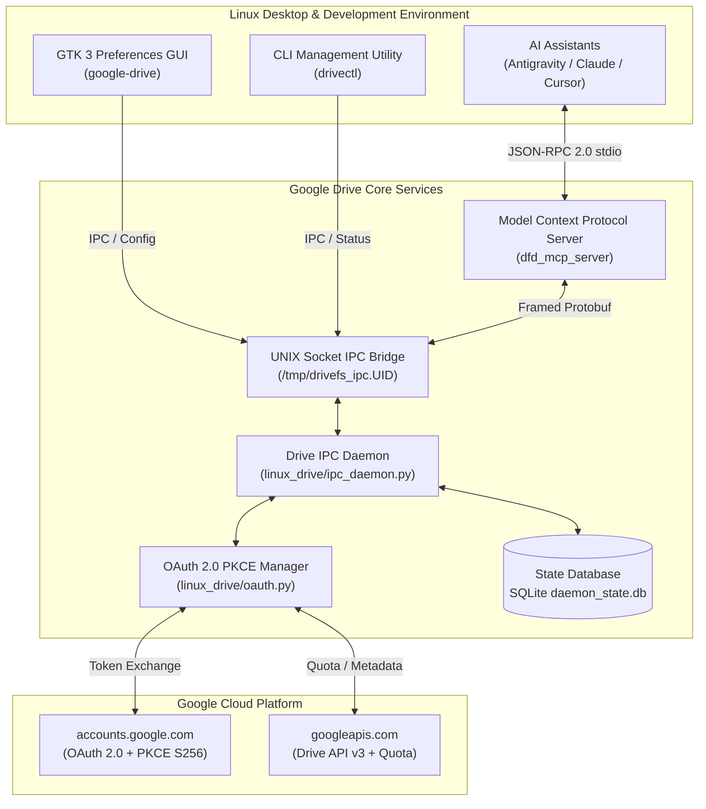

# Google Drive Desktop & MCP Server for Linux

[](https://aisgit.armellini.net/aelmark/google-drive)
[](https://www.python.org/)
[](https://www.gtk.org/)
[](https://modelcontextprotocol.io/)
[](LICENSE)

A native Linux desktop client, background synchronization engine, and Model Context Protocol (MCP) server for Google Drive. Clean-room engineered from the official Google Drive Desktop binary protocols, providing Linux users with first-class desktop integration and enabling AI coding assistants to seamlessly interact with local and cloud files.

---

## Highlights

- **Native Desktop Integration**: Pure GTK 3 configuration interface (`google-drive`) following GNOME Human Interface Guidelines, complete with high-resolution app icons and desktop menu launchers.
- **Reverse-Engineered IPC Protocol**: Drop-in compatible with the official Google Drive C++ core engine (`Cello`) using length-delimited Protocol Buffers over local UNIX domain sockets (`/tmp/drivefs_ipc.<UID>`) with kernel `SO_PEERCRED` UID security validation.
- **Embedded MCP Server (`dfd_mcp_server`)**: Exposes native Model Context Protocol tools directly to AI coding assistants (Google Antigravity, Claude Desktop, Cursor, Zed) for automated syncing, file sharing, URL resolution, and quota tracking.
- **Seamless OAuth 2.0 PKCE Flow**: Zero-configuration out of the box using built-in official desktop credentials or custom Google Cloud Console project credentials. Automates browser consent and loopback token capture on `127.0.0.1:8085`.
- **Zero Third-Party Pip Dependencies**: Engineered strictly with the Python 3.10+ standard library (`urllib`, `http.server`, `hashlib`, `secrets`, `sqlite3`), ensuring zero dependency conflicts and ultra-fast Debian `.deb` packaging.
- **Systemd User Service**: Automatic daemon management via `systemctl --user enable --now google-drive` with crash recovery and socket health checking.
- **Comprehensive CLI (`drivectl`)**: Control daemon state, manage synced folders, inspect live cloud storage quotas, and configure streaming parameters directly from the terminal.

---

## Architecture



---

## Installation

### Method 1: One-Line Installer (Recommended)

Run the automated installer script via `curl`:

```bash
curl -fsSL https://aisgit.armellini.net/aelmark/google-drive/raw/branch/main/install.sh | bash
```

The script automatically detects your system environment:
- If root or `sudo` is available on Debian/Ubuntu/Pop!_OS, it installs the complete `.deb` package system-wide.
- If running without root, it installs smoothly in **User Mode** directly into `~/.local/bin` and `~/.local/share`.

---

### Method 2: Debian Package (`.deb`)

If you have cloned the repository or downloaded the `.deb` directly:

```bash
# Install via apt to resolve any system dependencies automatically
sudo apt-get update
sudo apt-get install -y --fix-broken ./dist/google-drive-desktop_1.0.0_all.deb

# Enable and start the user background service
systemctl --user daemon-reload
systemctl --user enable --now google-drive
```

---

### Method 3: User-Mode (No Root / Sudo Required)

For environments where you do not have root privileges:

```bash
./install.sh --user
```

This installs binaries into `~/.local/bin`, libraries into `~/.local/share/google-drive`, desktop shortcuts into `~/.local/share/applications`, and activates a user-level systemd service in `~/.config/systemd/user/google-drive.service`.

---

## Connecting Your Google Account

### Option 1: Via the Preferences GUI
1. Open the application launcher and search for **Google Drive**, or run:
   ```bash
   google-drive
   ```
2. Navigate to the **Settings** tab.
3. Click the blue **"Sign in with Google..."** button.
4. Your default browser opens to the Google OAuth consent page. Approve the prompt, and the app connects automatically.

### Option 2: Via the Terminal
Run the CLI authorization command:
```bash
drivectl auth login
```
The command generates an RFC 7636 PKCE pair, opens your browser, listens for the callback on `http://127.0.0.1:8085/`, exchanges the code for offline refresh tokens, and saves credentials in `~/.config/google-drive/tokens.json` (`0600` permissions).

Check authentication state and storage quota anytime:
```bash
drivectl auth status
```

Output:
```text
==================================================
 Google Drive Account & OAuth Status
==================================================
 Credentials Mode : Default Official Desktop Client
 Client ID        : 947318989803-6bn6qk8qdgf4...usercontent.com
 Status           : 🟢 Authenticated
 Email            : user@example.com
 Name             : User Name
 Connected Since  : 2026-10-10T13:47:18Z
 Cloud Storage    : 4.12 GB / 15.0 GB (27.5%)
 Access Token TTL : 3540s remaining (auto-refreshes)
==================================================
```

---

### Custom Google Cloud Project Credentials (Optional)

By default, the client uses the extracted official Google Drive Desktop credentials. If you prefer to use your own Google Cloud Console OAuth 2.0 Client:

1. Create a project in [Google Cloud Console](https://console.cloud.google.com/).
2. Enable the **Google Drive API**.
3. Create an **OAuth 2.0 Client ID** with type **Desktop app**.
4. Set credentials via CLI:
   ```bash
   drivectl auth set-credentials <CLIENT_ID> <CLIENT_SECRET>
   # or import the downloaded client_secret_*.json
   drivectl auth import-credentials ~/Downloads/client_secret_*.json
   ```
5. Or configure them in the GUI under **Settings > Advanced: Custom Google Cloud OAuth 2.0 Credentials**.
6. Run `drivectl auth reset-credentials` at any time to revert to default credentials.

---

## CLI Reference: `drivectl`

The `drivectl` utility provides complete command-line control:

| Command | Arguments | Description |
|---|---|---|
| `drivectl status` | `[--json]` | Show background daemon health, account status, and tracked folders |
| `drivectl auth login` | `[--no-browser] [--port PORT]` | Authenticate Google Account via browser PKCE flow |
| `drivectl auth status` | - | Display OAuth connection, email, and live cloud storage quota |
| `drivectl auth logout` | - | Revoke Google tokens and disconnect active account |
| `drivectl auth set-credentials` | `<CLIENT_ID> <CLIENT_SECRET>` | Configure custom Google Cloud Console OAuth client |
| `drivectl auth import-credentials` | `<PATH_TO_JSON>` | Import Google Cloud `client_secret_*.json` |
| `drivectl auth reset-credentials` | - | Reset to default official desktop client credentials |
| `drivectl add` | `<PATH> [--mode mirror\|stream]` | Add a local directory to Google Drive synchronization |
| `drivectl list` | - | List all currently tracked directories and sync states |
| `drivectl settings` | - | Open native GTK 3 Preferences configuration dialog |
| `drivectl start` | - | Launch background IPC daemon |
| `drivectl stop` | - | Terminate running IPC daemon |
| `drivectl config show` | - | Print entire active JSON configuration |
| `drivectl config set` | `<KEY> <VALUE>` | Update specific setting (e.g. `storage.sync_mode`) |

---

## Model Context Protocol (MCP) Integration

The included `dfd_mcp_server` implements the Model Context Protocol (JSON-RPC 2.0 stdio), allowing autonomous AI agents to interact with Google Drive.

### Configuration for Antigravity & Claude Desktop

Add the following to your `mcp_config.json` (e.g. `~/.gemini/antigravity-cli/mcp_config.json` or `~/.config/Claude/claude_desktop_config.json`):

```json
{
  "mcpServers": {
    "google-drive": {
      "command": "dfd_mcp_server",
      "args": []
    }
  }
}
```

### Available MCP Tools

1. **`dfd_get_sync_status`**: Check if a local file or directory is actively synced (`synced`, `syncing`, `untracked`).
2. **`dfd_add_folder_to_sync`**: Add local directory to sync in `stream` or `mirror` mode. In stream mode, relocates folder into My Drive and creates a transparent symlink.
3. **`dfd_get_drive_url`**: Retrieve the web URL (`https://drive.google.com/...`) for any tracked file or folder.
4. **`dfd_list_tracked_folders`**: List all synced local directories across accounts.
5. **`dfd_open_acl_dialog`**: Launch the Google Drive sharing and permission dialog for an item.
6. **`dfd_get_account_info`**: Query account authentication status, user profile, and cloud storage quota metrics.

---

## File Synchronization Modes

| Mode | Behavior | Best Used For |
|---|---|---|
| **Stream** | Stores all files in the cloud only. Files are downloaded on-demand when accessed and cached locally with LRU eviction. Folders are symlinked into My Drive. | Conserving local SSD storage, large video or dataset repositories. |
| **Mirror** | Stores all files both in the cloud and locally on your computer. All files are available offline at all times. Bidirectional syncing reflects edits immediately. | Working offline, project source code repositories, frequent document editing. |

---

## Updating & Uninstallation

### Updating
Run the update script to pull the latest changes and update your installation:
```bash
./update.sh
```

### Uninstallation
Run the uninstaller script to cleanly remove application binaries, desktop shortcuts, and systemd services:
```bash
./uninstall.sh

# To also delete credentials, config, and cache databases:
./uninstall.sh --purge
```

---

## Repository & Development

- **Forgejo Repository**: [https://aisgit.armellini.net/aelmark/google-drive](https://aisgit.armellini.net/aelmark/google-drive)
- **Maintainer**: Mark Sterling (`aelmark`)
- **License**: Apache-2.0
